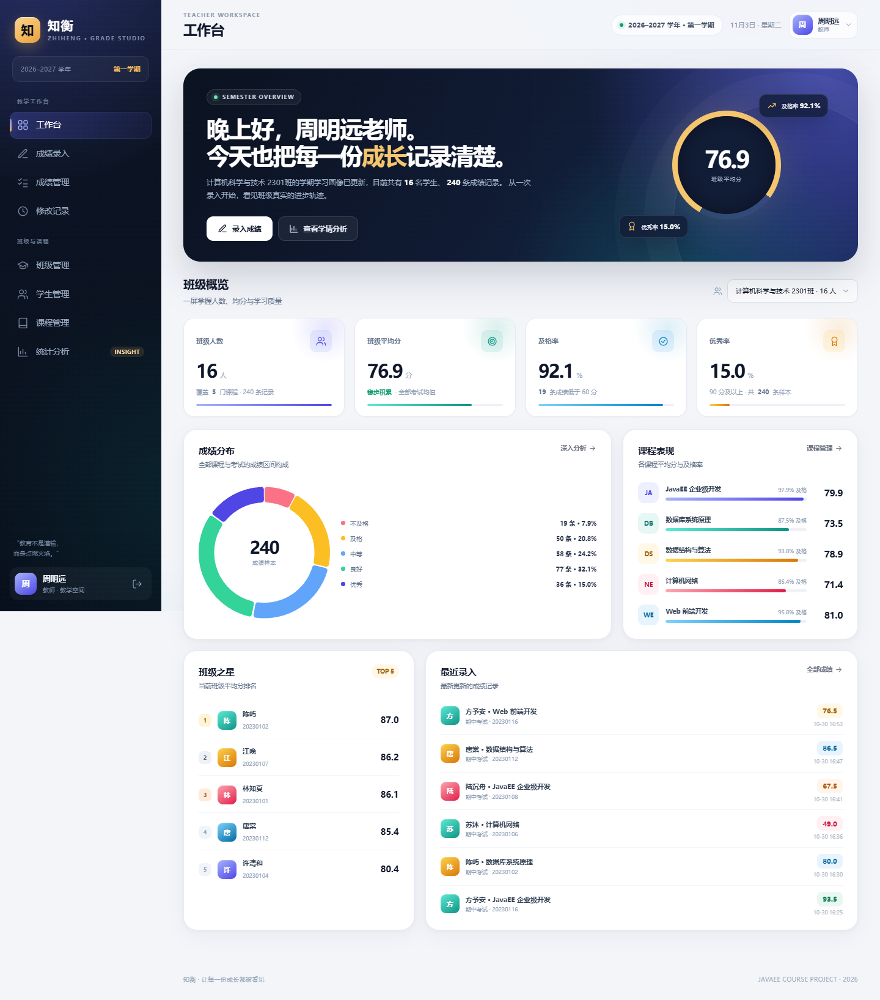
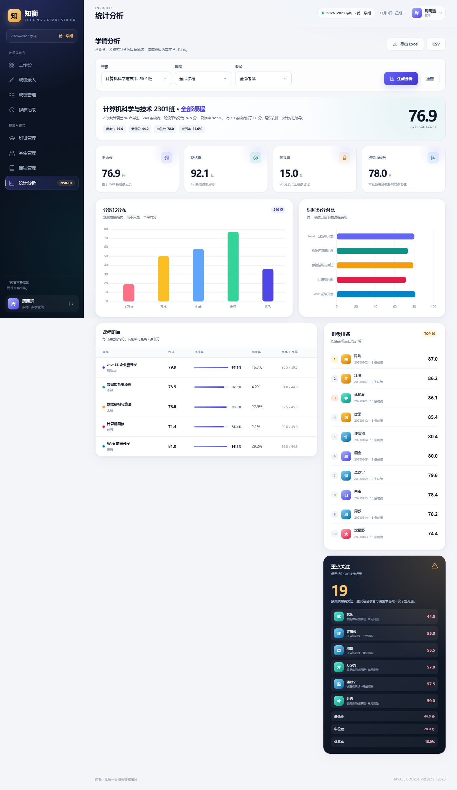
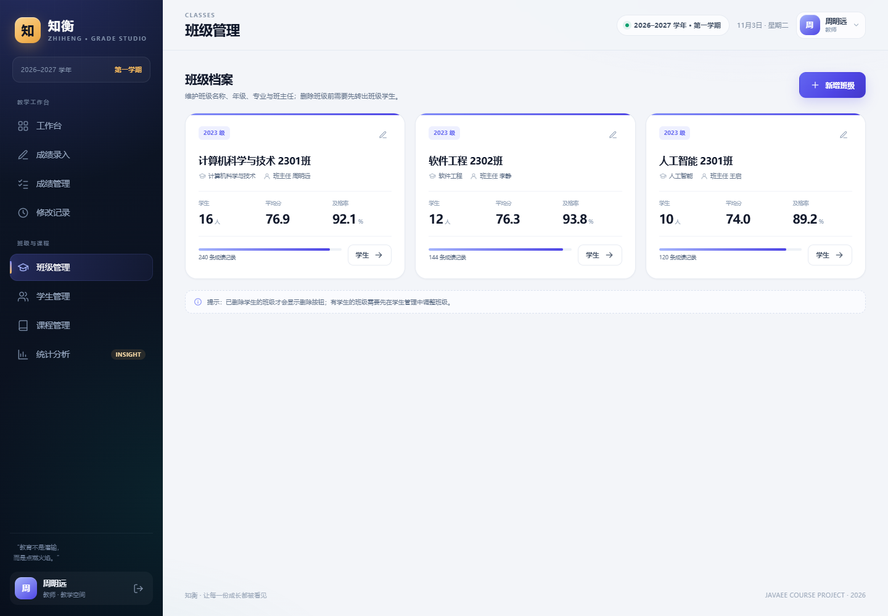
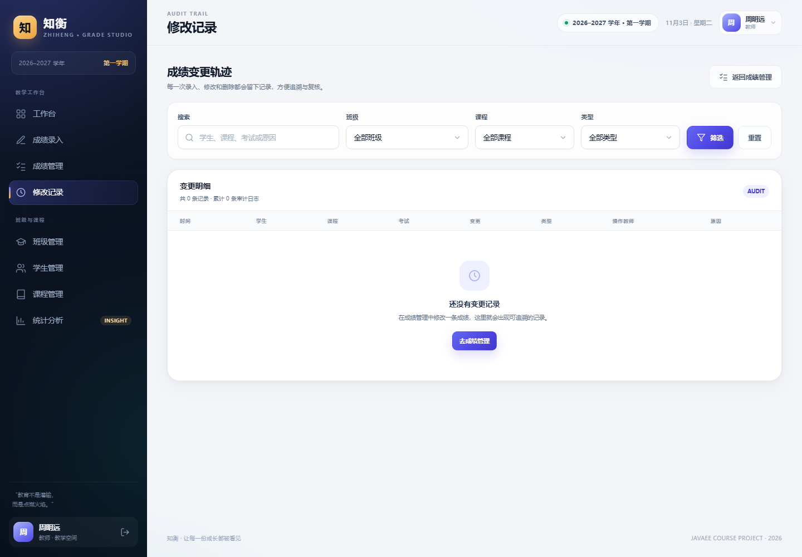
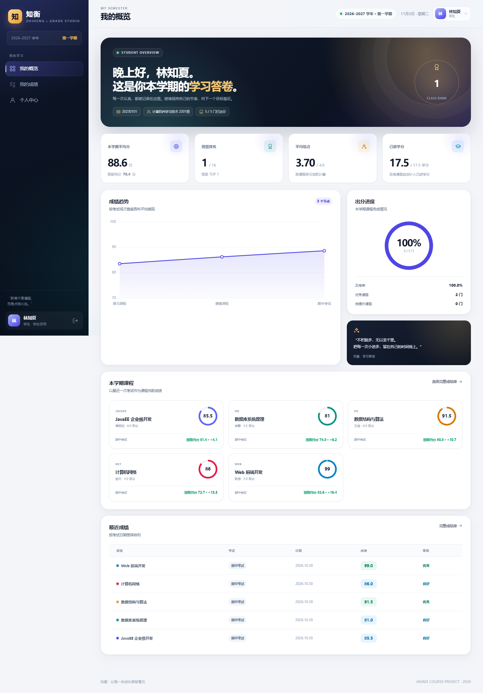

# 知衡 · 班级学生成绩管理系统

> JavaEE 课程设计 · 基于 **Jakarta EE（Servlet + JSP + JSTL + JDBC）** 的班级成绩管理系统  
> 教师录入、学生查询、平均分与及格率统计，一套可直接在 IDEA 中运行、也适合作为期末大作业的完整项目。


---

## 一、项目简介

**知衡**是一个面向班级教学场景的成绩管理系统。教师可以在一个清爽的工作台里完成学生档案、课程、成绩录入和学情分析；学生登录后可以查看自己的平均分、班级排名、绩点、课程成绩与完整成绩单。

项目没有使用 Spring Boot，而是使用 **JavaEE 的 Servlet / JSP 规范**，配合 Filter、Listener、JDBC、JSTL 和内置 Tomcat，能够直观体现 JavaEE Web 应用的分层与请求处理流程，适合作为 JavaEE 课程设计或期末大作业。

系统内置了一套 3 个班级、38 名学生、5 门课程、500 余条成绩的演示数据，首次启动自动生成，打开即可演示。

---

## 二、功能清单

### 教师端

| 模块 | 功能 |
| --- | --- |
| 工作台 | 班级切换、班级人数、平均分、及格率、优秀率、成绩分布、课程表现、班级之星、最近录入 |
| 成绩录入 | 按班级 / 课程 / 考试选择名单；整班批量录入；键盘 Enter 连续录入；实时计算本次均分与及格率；0–100 校验；新增与更新自动识别 |
| Excel 导入 | 下载带学生名单和成绩校验的 Excel 模板；上传后自动校验学号、分数并批量新增 / 更新；支持 .xlsx / .xls |
| 成绩管理 | 按班级、课程、考试、关键词筛选；分页；单条修改（可填写修改原因）；删除；CSV / Excel 导出 |
| 修改记录 | 记录录入、修改、删除的分数前后值、操作教师、原因和时间；支持按班级 / 课程 / 类型筛选 |
| 学生管理 | 学生新增、编辑、删除、搜索、班级筛选；自动开学生登录账号；显示个人平均分与及格率 |
| 班级管理 | 班级新增、编辑、删除；班级人数、平均分、及格率；有学生的班级禁止删除 |
| 课程管理 | 课程新增、编辑、删除；课程代码唯一校验；已有成绩的课程禁止删除；按班级查看课程均分与及格率 |
| 统计分析 | 平均分、及格率、优秀率、中位数、最高分、最低分；分数段分布；课程均分对比；班级排名；重点关注名单；CSV / Excel 导出 |
| 个人中心 | 账号信息、最近登录、修改密码、密码强度提示 |

### 学生端

| 模块 | 功能 |
| --- | --- |
| 我的概览 | 平均分、班级排名、GPA、已获学分、出分进度、成绩趋势、课程卡片、最近成绩 |
| 我的成绩 | 完整成绩单、课程 / 考试筛选、打印成绩单（可另存为 PDF） |
| 个人中心 | 学号、班级、学籍状态、最近登录、修改密码 |

### 通用能力

- 教师 / 学生双角色登录，Session 会话鉴权，越权访问自动拦截
- BCrypt 密码哈希，登录成功轮换 Session，防会话固定
- 响应式布局，电脑、平板、手机均可使用
- Chart.js 全部本地化，不依赖任何外部 CDN，断网也能正常展示
- 自定义 404 / 500 页面、全站表单提示、删除二次确认、空状态、加载状态
- 所有列表支持空数据状态，所有写操作使用 PRG（Post/Redirect/Get）避免重复提交

---

## 三、技术栈

| 层次 | 使用技术 |
| --- | --- |
| 语言 | Java 17（可在 JDK 17 / 21 / 26 运行） |
| Web 规范 | Jakarta Servlet 6.1、JSP 4.0、JSTL 3.0 |
| Web 容器 | Apache Tomcat 11.0.20（内嵌，无需额外安装） |
| 控制层 | Servlet、Filter、Listener |
| 视图层 | JSP、JSTL、EL、HTML5、CSS3、原生 JavaScript |
| 数据访问 | JDBC + PreparedStatement，手写 DAO 层 |
| Excel | Apache POI 5.2.5（模板导出、导入解析、数据校验） |
| 数据库 | H2 2.2.224（文件模式，零安装） |
| 安全 | Session 鉴权、BCrypt 密码哈希、输出转义、PreparedStatement 防注入 |
| 图表 | Chart.js 4.4.7（已放入项目本地） |
| 构建 | Maven 3.8+ |

> 说明：JavaEE 从 Java EE 8 之后迁移到 Eclipse 基金会，包名由 `javax.*` 变为 `jakarta.*`。  
> 本项目使用的是现代 JavaEE 命名空间，即 **Jakarta EE**，这是目前 Tomcat 10/11 的标准写法。

---

## 四、在 IDEA 中运行（推荐）

### 1. 环境要求

- IntelliJ IDEA 2024.1 或更高版本（社区版 / 旗舰版都可以）
- JDK 17 及以上，推荐 **JDK 21**
- Maven 3.8+（IDEA 自带 Maven 也可以）
- **不需要**单独安装 Tomcat

### 2. 打开项目

在 IDEA 中选择：

```text
File → Open → 选择 class-grade-manager 文件夹 → OK
```

不要打开它的父文件夹。IDEA 识别到 `pom.xml` 后会自动导入 Maven，等待右下角依赖下载完成。

### 3. 设置 JDK

```text
File → Project Structure → Project
Project SDK：选择 JDK 21（或本机 JDK 17+）
Language level：17
```

如果列表里没有 JDK，点击 `Add SDK → JDK`，选择本机 JDK 安装目录即可。

### 4. 运行

**最快方式（不配置 IDEA 也能跑）：**

直接双击项目根目录下的 `run.bat`。脚本会自动执行 Maven 编译并启动内置 Tomcat，随后浏览器打开 <http://localhost:8080>。第一次运行会下载 Maven 依赖，稍等片刻即可。

如果双击没有反应，在项目根目录的终端执行：

```bash
run.bat
```

或：

```bash
mvn compile exec:java
```

**在 IDEA 中运行：**

项目根目录已经附带运行配置：

```text
右上角运行配置选择「知衡 · 启动系统」→ 点击绿色三角形
```

如果没看到该配置，直接打开：

```text
src/main/java/com/zhihang/grade/Launcher.java
```

点击 `main` 方法左侧的绿色箭头，或右上角绿色运行按钮（当前文件）运行即可。

> 如果 IDEA 右侧没有 Maven 面板，右键项目根目录的 `pom.xml` → **Add as Maven Project**，然后点击 Maven 面板的刷新按钮。

启动成功后控制台会输出：

```text
访问地址   http://localhost:8080
教师账号   teacher / 123456
学生账号   20230101 / 123456
```

浏览器一般会自动打开；如果没有自动打开，手动访问 <http://localhost:8080>。

### 5. 命令行运行（可选）

```bash
mvn compile exec:java
```

指定端口：

```bash
mvn compile exec:java -Dserver.port=8081
```

也可以先打包成 WAR：

```bash
mvn clean package
```

生成文件：`target/class-grade-manager.war`，可部署到 Tomcat 10.1 / 11（**不要用 Tomcat 9**，它是旧的 `javax` 命名空间）。

---

## 五、演示账号

| 角色 | 账号 | 密码 | 说明 |
| --- | --- | --- | --- |
| 教师 | `teacher` | `123456` | 周明远老师，可管理 3 个班级 |
| 学生 | `20230101` | `123456` | 林知夏，计算机科学与技术 2301班 |
| 学生 | `20230102` | `123456` | 陈屿，同班 |
| 学生 | `20230201` | `123456` | 程砚，软件工程 2302班 |

> 新增学生时，系统会自动创建登录账号：**账号 = 学号，初始密码 = 123456**。  
> 所有演示学生的初始密码也都是 `123456`。

---

## 六、界面预览

### 教师工作台



### 学情分析



### 班级管理



### 修改记录



### 学生概览



---

## 七、项目结构

```text
class-grade-manager/
├─ pom.xml
├─ README.md
├─ .gitignore
├─ .run/
│  └─ Launcher.run.xml                 # IDEA 运行配置
└─ src/
   ├─ main/
   │  ├─ java/com/zhihang/grade/
   │  │  ├─ Launcher.java              # 内嵌 Tomcat 启动器
   │  │  ├─ config/                    # 数据库、建表、演示数据
   │  │  ├─ dao/                       # JDBC DAO
   │  │  ├─ model/                     # 实体 / 页面数据模型
   │  │  ├─ service/                   # 业务逻辑、校验、事务
   │  │  ├─ util/                      # 密码、CSV、Web、JSON 工具
   │  │  └─ web/
   │  │     ├─ *Servlet.java           # 控制器
   │  │     ├─ filter/                 # 编码、鉴权、Flash、异常日志
   │  │     └─ listener/               # 应用启动初始化
   │  ├─ resources/                    # 预留配置目录
   │  └─ webapp/
   │     ├─ assets/                    # CSS / JS / 图标 / Chart.js
   │     └─ WEB-INF/
   │        ├─ web.xml                 # Servlet / Filter / 错误页配置
   │        └─ views/                  # JSP 页面与公共片段
   └─ test/                            # 测试目录
```

---

## 八、数据库说明

- 使用 H2 文件数据库，默认位置：`./data/zhihang.mv.db`
- 首次启动自动建表，并写入演示数据
- 重启项目数据不会丢失
- 数据库文件与日志已在 `.gitignore` 中忽略，不会提交到 GitHub

### 重置演示数据

1. 停止 IDEA 中运行的程序
2. 删除项目根目录下的 `data` 文件夹
3. 重新运行 `Launcher`

### 主要数据表

| 表 | 作用 |
| --- | --- |
| `classes` | 班级信息 |
| `students` | 学生档案 |
| `courses` | 课程信息 |
| `grades` | 成绩记录（学生 + 课程 + 考试唯一） |
| `grade_logs` | 成绩变更审计记录（录入 / 修改 / 删除） |
| `users` | 登录账号（教师 / 学生） |

---

## 九、上传到 GitHub（手把手）

> 这一部分请你自己操作。下面的命令都在 **项目根目录** 执行（即 `pom.xml` 所在目录）。

### 第 0 步：确认不提交运行产物

项目已经配置好 `.gitignore`，以下内容不会上传：

```text
target/        Maven 编译产物
data/          H2 数据库文件
logs/          异常日志
.idea/         IDEA 个人配置
*.iml
```

提交前可以执行：

```bash
git status
```

如果看到 `target/`、`data/`、`logs/`，说明它们没有被忽略，先检查 `.gitignore`。

### 第 1 步：安装并配置 Git

确认已安装 Git：

```bash
git --version
```

配置用户名和邮箱（只配置一次）：

```bash
git config --global user.name "你的名字"
git config --global user.email "你的邮箱"
```

### 第 2 步：在项目根目录初始化仓库

```bash
git init
git add .
git commit -m "feat: 完成班级学生成绩管理系统"
```

### 第 3 步：在 GitHub 创建空仓库

1. 打开 <https://github.com>
2. 右上角 `+` → `New repository`
3. Repository name 填：`class-grade-manager`
4. 选择 `Public` 或 `Private`
5. **不要勾选** `Add a README file`、`.gitignore`、`license`（保持空仓库）
6. 点击 `Create repository`

### 第 4 步：关联远程仓库并推送

把下面地址中的 `你的用户名` 换成你的 GitHub 用户名：

```bash
git branch -M main
git remote add origin https://github.com/你的用户名/class-grade-manager.git
git push -u origin main
```

如果提示 `remote origin already exists`，改用：

```bash
git remote set-url origin https://github.com/你的用户名/class-grade-manager.git
git push -u origin main
```

### 第 5 步：输入账号密码 / Token

GitHub 现在不接受直接使用登录密码推送 HTTPS 仓库，需要使用 **Personal Access Token（PAT）**：

1. GitHub 右上角头像 → `Settings`
2. 左侧最下方 `Developer settings`
3. `Personal access tokens` → `Tokens (classic)`
4. `Generate new token (classic)`
5. Note 填 `idea-push`，Expiration 按需选择
6. 勾选 `repo` 权限
7. 生成后复制 Token（只显示一次）
8. 在 IDEA 或命令行提示输入密码时，**粘贴 Token 作为密码**

也可以直接使用 **GitHub Desktop**：添加本地仓库 → Publish repository，界面化操作更简单。

### 第 6 步：在 IDEA 里后续提交

如果你更喜欢在 IDEA 里操作：

```text
VCS → Enable Version Control Integration → Git
```

之后修改代码，在 `Commit` 面板勾选文件 → 写提交信息 → `Commit`；需要同步时点击 `Push`。

### 常用命令

```bash
git status                 # 查看改动
git add .                  # 暂存全部改动
git commit -m "说明"       # 提交
git push                   # 推送到 GitHub
git log --oneline          # 查看提交历史
```

---

## 十、课程设计说明（答辩可讲）

### 1. 分层结构

```text
浏览器
  ↓
Filter（编码 / 登录鉴权 / Flash 消息 / 异常日志）
  ↓
Servlet（接收参数、调用 Service、选择 JSP）
  ↓
Service（业务校验、事务、统计计算）
  ↓
DAO（JDBC PreparedStatement）
  ↓
H2 数据库
  ↓
JSP + JSTL + EL（服务端渲染）
```

### 2. 关键实现点

- **登录鉴权**：`AuthFilter` 统一拦截，Session 中保存 `SessionUser`，按角色限制教师端 / 学生端页面；登录成功时销毁旧 Session 再创建新 Session。
- **成绩批量录入**：整班名单一次提交，服务端逐条校验 0–100，使用 JDBC 事务批量写入；同一学生 + 课程 + 考试自动识别为更新。
- **Excel 导入**：使用 Apache POI 生成带学生名单、成绩预填和 0–100 数据校验的模板；导入时先完整校验学号、分数，全部通过后再在一个事务中批量写入。
- **修改审计**：每次成绩录入、修改、删除都写入 `grade_logs`，保留旧分、新分、操作教师、原因和时间；删除成绩后审计记录仍然保留。
- **统计口径**：平均分为成绩记录均值；及格率为 `>= 60` 的记录占比；优秀率为 `>= 90` 的记录占比；中位数在 Java 层排序计算。
- **学生排名**：按班级内每名学生“每门课程最近一次考试”的平均分排序，保证口径一致。
- **重点关注**：统计不及格记录，并按学生去重后列出最低分课程，方便教师个别沟通。
- **GPA**：按课程学分加权，90 分以上 4.0，60 分以下 0。
- **安全细节**：BCrypt 存储密码、PreparedStatement 防 SQL 注入、JSTL `c:out` / `fn:escapeXml` 防 XSS、站内重定向校验防开放重定向。
- **事务**：新增学生同时创建登录账号；批量录入成绩；修改 / 删除成绩与审计日志；删除学生级联删除账号和成绩，均使用事务保证一致性。

### 3. 可扩展方向

- 接入 MySQL（修改 `Database` 中的 JDBC URL 与驱动）
- 增加考试管理、成绩审核流、多教师 / 管理员
- 增加学生 Excel 批量导入、成绩单 PDF 下载
- 拆分为前后端分离 + REST API
- 增加 CSRF、登录限流、数据备份、邮件通知

---

## 十一、常见问题

### Q1：IDEA 打开后依赖爆红 / 页面 404？

先确认 Maven 已导入完成：

```text
右侧 Maven 面板 → Reload All Maven Projects
```

然后确认运行的是 `Launcher`，不是某个 Servlet。

### Q2：8080 端口被占用？

在 IDEA 运行配置的 `VM options` 中加入：

```text
-Dserver.port=8081
```

然后访问 <http://localhost:8081>。

### Q3：控制台中文乱码？

这是 Windows 终端编码导致的显示问题，不影响网页。可以在 IDEA：

```text
Help → Edit Custom VM Options
```

加入：

```text
-Dfile.encoding=UTF-8
```

### Q4：想恢复初始演示数据？

停止程序 → 删除 `data` 文件夹 → 重新运行。

### Q5：可以使用 MySQL 吗？

可以。把 `pom.xml` 中的 H2 依赖换成 MySQL 驱动，修改 `Database.url()`，并把建表语句中的 H2 语法调整为 MySQL 语法即可。当前为了保证“打开即运行”，默认使用 H2。

### Q6：为什么不用 Spring Boot？

课程要求使用 JavaEE 框架。本项目直接使用 JavaEE 的 Servlet、JSP、JSTL、Filter、Listener、JDBC 规范，配合 Tomcat 容器，更贴合 JavaEE 课程知识点，也方便答辩时讲清请求处理流程。

---

## 十二、说明

- 本项目为课程设计演示项目，数据均为虚构，仅用于学习与展示。
- 图表库 Chart.js 已本地化，遵循其 MIT License。
- 如需提交给老师，建议同时保留本 README，按“功能清单 → 技术栈 → 运行方式 → 课程设计说明”的顺序讲解。
